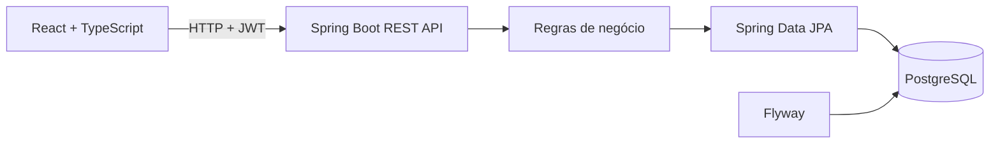

# FinancesFlow

[](https://github.com/lucastomazcs/FinancesFlow/actions/workflows/ci.yml)

Aplicação full stack para controle financeiro pessoal. O projeto combina uma API REST em Java com uma interface web em React para registrar transações, acompanhar orçamentos e controlar cartões e faturas.

## Funcionalidades

- Cadastro e login com autenticação JWT.
- Transações de receita e despesa, com edição, exclusão, filtros e paginação.
- Resumo mensal de receitas, despesas e saldo.
- Orçamentos por categoria, com gastos, valor restante e aviso de limite excedido.
- Cartões de crédito, compras parceladas, faturas e registro de pagamento.
- Isolamento dos dados: cada pessoa acessa apenas os próprios registros.
- Migrações de banco versionadas com Flyway e documentação de API com Swagger / OpenAPI.

## Tecnologias

| Camada | Tecnologias |
| --- | --- |
| Backend | Java 21, Spring Boot, Spring Security, JWT, Spring Data JPA |
| Banco | PostgreSQL, Flyway |
| Frontend | React, TypeScript, Vite |
| Testes | JUnit, Mockito, Spring MockMvc, Testcontainers |
| Ambiente | Docker Compose, GitHub Actions |

## Como a aplicação funciona



O frontend envia requisições autenticadas para a API. Os controllers recebem os pedidos, os serviços aplicam as regras de negócio e os repositórios persistem os dados no PostgreSQL. O Flyway cria e atualiza o esquema do banco por migrações.

## Executar localmente

### Requisitos

- JDK 21
- Docker Desktop com Docker Compose
- Node.js 20 ou superior e npm

### Backend e banco de dados

Na raiz do projeto, execute:

```bash
docker compose up -d --build
```

A API fica em `http://localhost:8080`. A interface Swagger fica em `http://localhost:8080/swagger-ui/index.html`.

### Frontend

Em outro terminal:

```bash
cd frontend
npm ci
npm run dev
```

Abra `http://localhost:5173`. Se essa porta estiver ocupada, o Vite informa a porta alternativa no terminal. O Vite encaminha as chamadas `/api` para o backend local.

Para parar os containers, execute `docker compose down`. O banco usa um volume Docker, então os dados persistem entre reinicializações. `docker compose down -v` também remove o volume e apaga os dados locais.

## Testes e compilação

Com o Docker Desktop ativo, rode os testes do backend na raiz:

```bash
mvn test
```

Testes unitários usam mocks para verificar regras de negócio. Testes de integração iniciam um PostgreSQL temporário com Testcontainers e exercitam as rotas HTTP, autenticação e persistência sem tocar no banco local do Compose.

Para compilar o frontend:

```bash
cd frontend
npm ci
npm run build
```

## Integração contínua

O workflow do GitHub Actions roda em cada push e pull request. Em paralelo, ele executa `mvn test` com Java 21 e compila o frontend com `npm ci` e `npm run build`. O job do backend usa Docker para iniciar o PostgreSQL temporário do Testcontainers.

## Endpoints principais

As rotas privadas exigem o token JWT retornado pelo login. No Swagger, use **Authorize** para informar `Bearer <token>`.

| Método | Endpoint | Uso |
| --- | --- | --- |
| `POST` | `/api/auth/register` | Criar conta |
| `POST` | `/api/auth/login` | Entrar e receber token |
| `GET`, `POST` | `/api/transactions` | Listar e criar transações |
| `GET`, `PUT`, `DELETE` | `/api/transactions/{id}` | Consultar, editar e remover uma transação |
| `GET` | `/api/reports/monthly?month=2026-10` | Consultar resumo mensal |
| `GET`, `POST` | `/api/budgets` | Listar e criar orçamentos |
| `GET`, `POST` | `/api/cards` | Listar e criar cartões |
| `POST` | `/api/cards/{cardId}/purchases` | Registrar compra parcelada |
| `GET` | `/api/cards/{cardId}/invoices?month=2026-11` | Consultar fatura |
| `POST` | `/api/cards/{cardId}/invoices/pay?month=2026-11` | Pagar fatura |

As transações aceitam filtros opcionais de mês, tipo e categoria, além de paginação. Os parâmetros detalhados estão no Swagger.

## Regras de negócio em destaque

- Um orçamento é único por usuário, categoria e mês.
- Os gastos do orçamento somam despesas da categoria e parcelas de cartão no mês de cada fatura.
- Compras no dia de fechamento do cartão ou depois entram na fatura seguinte.
- O pagamento da fatura libera o limite referente às parcelas pagas; parcelas futuras continuam comprometendo o limite.
- As consultas de transações, relatórios, cartões e orçamentos são limitadas à pessoa autenticada.

## Segurança e configuração

As credenciais presentes no `docker-compose.yml` são valores padrão para desenvolvimento local. Não as use em produção. A aplicação aceita configurações por variáveis de ambiente, incluindo `DB_URL`, `DB_USERNAME`, `DB_PASSWORD` e `JWT_SECRET`.

Arquivos `.env` são ignorados pelo Git. Nunca publique senhas reais, tokens ou segredos de produção; em ambientes hospedados, configure-os como secrets da plataforma.

## Estrutura do repositório

```text
.
├── .github/workflows/ci.yml   # Verificações automáticas no GitHub
├── frontend/                  # Interface React + TypeScript
├── src/main/java/             # API Java e regras de negócio
├── src/main/resources/        # Configuração e migrações Flyway
├── src/test/java/             # Testes unitários e de integração
├── docker-compose.yml         # API e PostgreSQL para desenvolvimento
└── pom.xml                    # Dependências e build Maven
```
