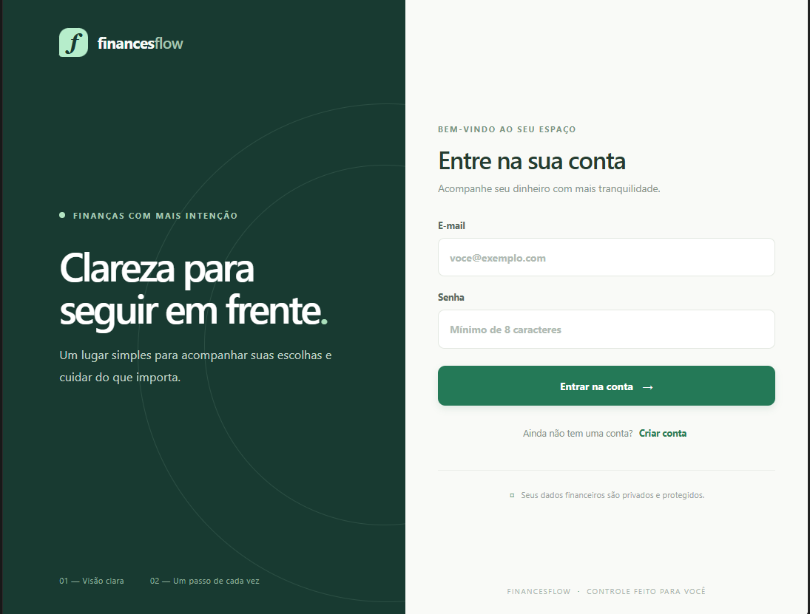
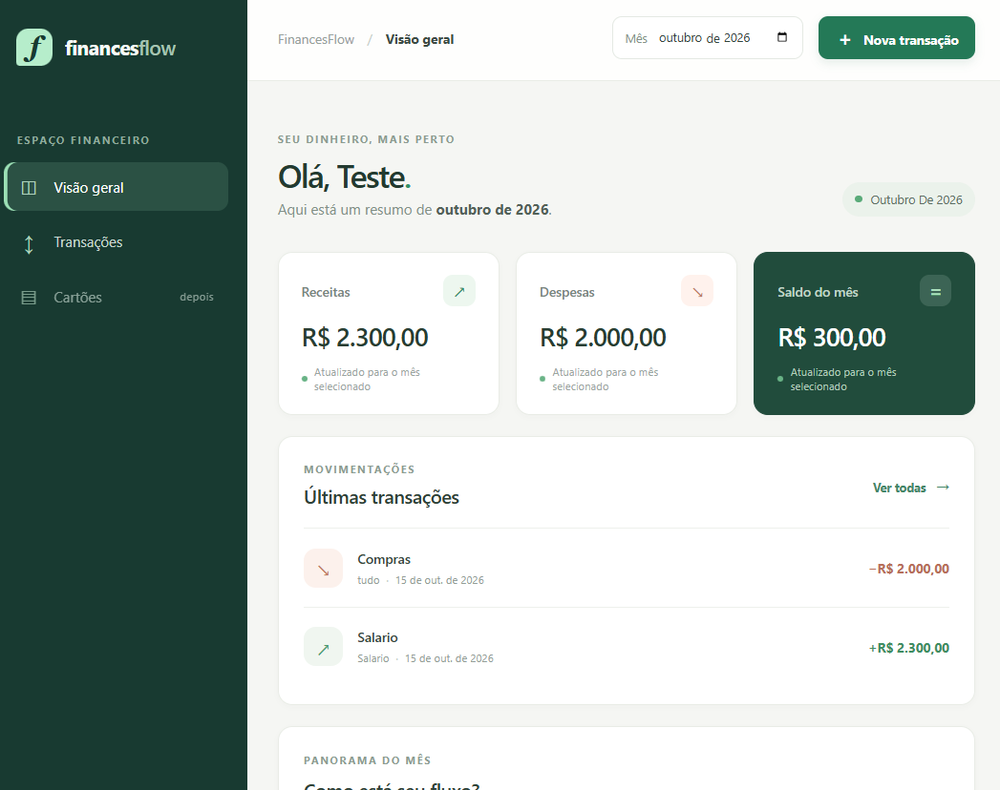
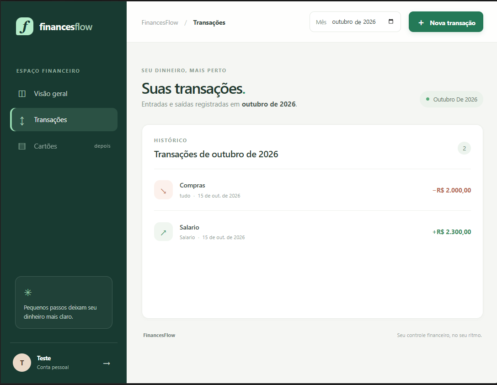
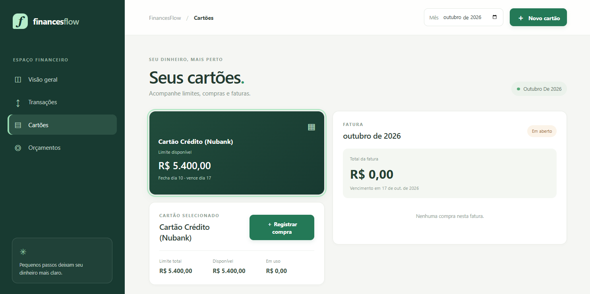

# Rascunho para LinkedIn

Estou desenvolvendo o **FinancesFlow**, um projeto pessoal para aprender e praticar desenvolvimento back-end com Java — e também construir uma aplicação full stack de ponta a ponta.

No back-end, implementei uma API REST com **Java 21 e Spring Boot**, autenticação JWT e isolamento dos dados por usuário. O projeto usa PostgreSQL com migrações Flyway e inclui regras para transações, orçamentos, cartões, compras parceladas e faturas.

Também trabalhei em testes unitários e de integração com JUnit, Mockito e Testcontainers, documentação com Swagger/OpenAPI, execução local com Docker Compose e integração contínua no GitHub Actions.

Na interface, usei React e TypeScript para criar login, visão geral financeira, histórico de transações e uma área para acompanhar cartões e faturas.

Foi um projeto importante para praticar conceitos que vão além de um CRUD: autenticação, autorização, regras de negócio, persistência, testes e integração entre front-end e back-end.

🔗 Código e instruções para executar: https://github.com/lucastomazcs/FinancesFlow

As imagens abaixo mostram a interface atual, com dados de demonstração.

#Java #SpringBoot #Backend #DesenvolvimentoWeb #React #TypeScript #Portfolio
